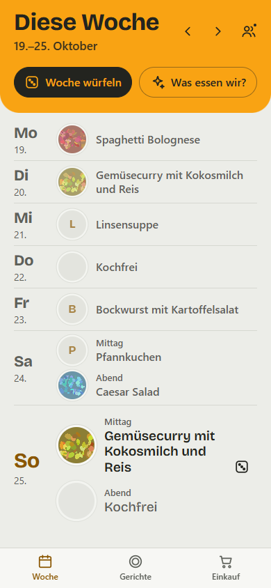
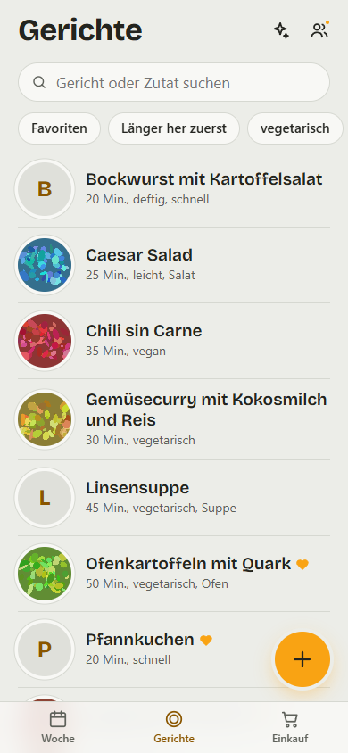
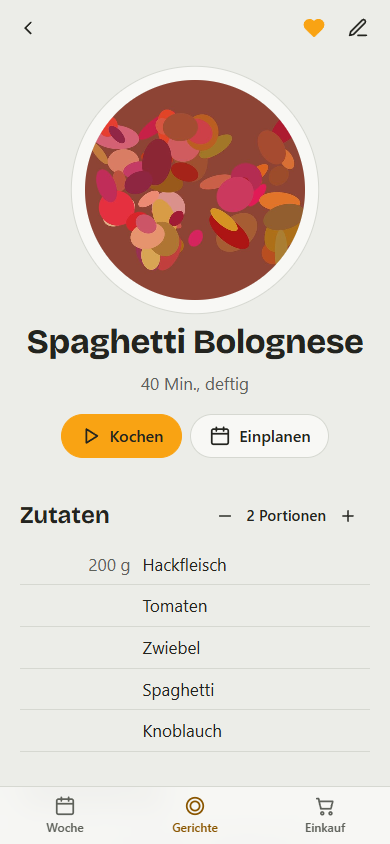
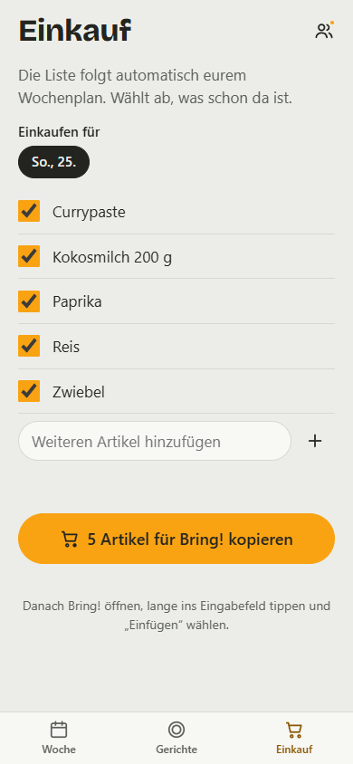
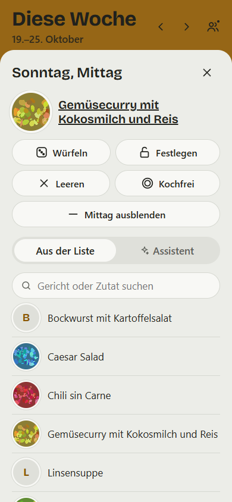
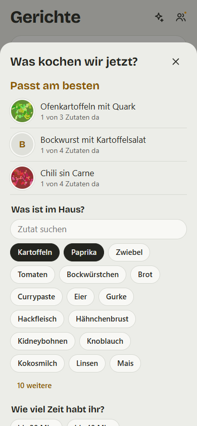
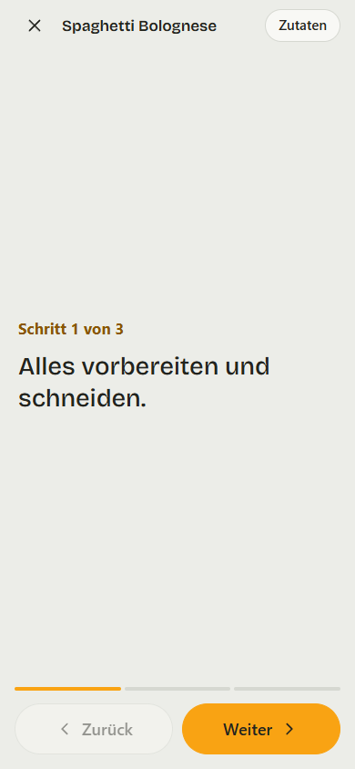
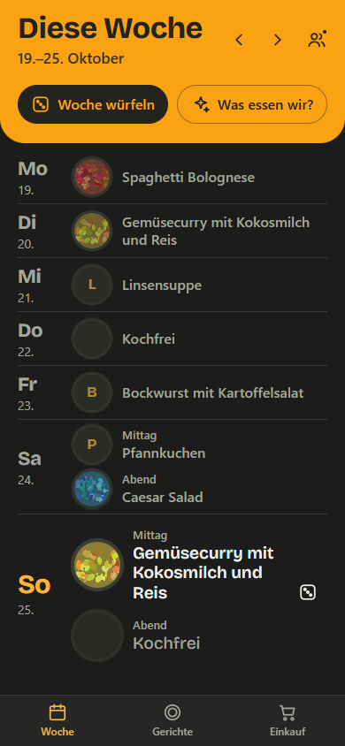

# Dishcovery

Eure Gerichte, euer Wochenplan, eure Einkaufsliste. Für alle im Haushalt, auch ohne Internet.

Dishcovery ist eine App fürs iPhone, die ihr direkt aus Safari auf den Home-Bildschirm legt. Ihr sammelt gemeinsam eure Lieblingsgerichte, plant die Woche, würfelt, wenn euch nichts einfällt, und schickt die Einkaufsliste mit einem Tipp an Bring!. Abgeglichen wird über einen geteilten Dropbox-Ordner. Einen eigenen Server oder ein Konto bei uns gibt es nicht.

**App öffnen:** https://kampfballerina.github.io/Dishcovery/

<p>
  
  
  
  
</p>

## Auf den Home-Bildschirm legen

1. Öffne https://kampfballerina.github.io/Dishcovery/ in **Safari**. In anderen Browsern bietet iOS das nicht an.
2. Tippe unten auf **Teilen** (das Quadrat mit dem Pfeil nach oben).
3. Scrolle nach unten und wähle **„Zum Home-Bildschirm“**, dann **„Hinzufügen“**.
4. Öffne Dishcovery ab jetzt über das neue Symbol. Die App läuft dann im Vollbild und funktioniert auch offline.

Updates kommen von selbst: Ist beim Öffnen Internet da, holt sich die App die neue Version automatisch.

## Erste Schritte

- **Allein ausprobieren:** Beim ersten Start „Erst mal allein ausprobieren“ wählen. Alles bleibt dann nur auf diesem Gerät, verbinden könnt ihr später jederzeit.
- **Mit dem Haushalt teilen:**
  1. Eine Person tippt auf **„Mit Dropbox verbinden“**. Die App legt in ihrer Dropbox den Ordner `Dishcovery` an.
  2. Unter **Haushalt** (Personen-Symbol oben rechts) lädt sie die anderen per E-Mail-Adresse ein. Dropbox schickt die Einladung.
  3. Die Eingeladenen legen die App ebenfalls auf den Home-Bildschirm und verbinden sich mit dem Dropbox-Konto genau dieser E-Mail-Adresse. Die App fragt dann „Du wurdest eingeladen“, ein Tipp auf **Beitreten** genügt.

Wer vorher schon allein Gerichte angelegt hat, behält sie beim Beitreten, sie werden mit denen des Haushalts zusammengeführt.

## Was die App kann

### Woche



- Jeder Tag hat ein **Abendessen**, auf Wunsch blendet **„+ Mittag“** auch ein Mittagessen ein.
- **Woche würfeln** füllt alle offenen Mahlzeiten ab heute zufällig. Dabei kommt kein Gericht zweimal in der Woche vor, Gerichte der Vorwoche werden gemieden und Favoriten kommen doppelt so oft dran. Der Würfel neben einem Tag würfelt nur diesen Tag.
- Ein Tipp auf eine Mahlzeit öffnet die Auswahl:
  - **Würfeln** für genau diese Mahlzeit
  - **Festlegen**: Das Gericht bleibt beim Würfeln stehen. Von Hand gewählte Gerichte sind automatisch festgelegt (Teller mit grünem Rand und Schloss).
  - **Kochfrei**: An diesem Tag wird nicht gekocht, zum Beispiel wenn ihr essen geht. Würfeln lässt ihn leer, und die Einkaufsliste plant nichts dafür ein.
  - **Leeren** oder **Mittag ausblenden**
  - ein Gericht **aus der Liste** wählen oder den **Assistenten** fragen
- **„Was essen wir?“** startet den Assistenten für die nächste offene Mahlzeit.
- Vergangene Tage bleiben als Rückblick stehen, sind aber nicht mehr planbar. Mit den Pfeilen geht es zur letzten und zur nächsten Woche.
- Ein Würfeln lässt sich über **„Rückgängig“** im Hinweis unten zurücknehmen.

### Gerichte

- Ein Gericht hat Name, **Foto**, Zutaten mit Menge und Einheit, Zubereitungsschritte, Portionen, Zeit, Schlagwörter, Notizen, einen **Videolink** und eine **Rezept-Quelle**. Mit dem Herz markiert ihr Favoriten.
- **Suche** nach Name oder Zutat, Filter für Favoriten und Schlagwörter, **„Länger her zuerst“** zeigt, was ihr lange nicht gegessen habt.
- Beim Anlegen werden **Zutaten aus anderen Gerichten vorgeschlagen**. So bleibt die Schreibweise einheitlich.
- „Tomate“ und „Tomaten“, „Bockwurst“ und „Bockwürstchen“ gelten als **dieselbe Zutat**, auf der Einkaufsliste und im Assistenten.
- Auf der Detailseite rechnet **− / +** die Mengen auf andere Portionen um.
- **Kochen** führt Schritt für Schritt im Vollbild durch das Rezept, mit großer Schrift und den Zutaten griffbereit. Der Bildschirm bleibt dabei an.
- **Einplanen** legt das Gericht direkt auf einen Tag.

### Assistent



Über den Funken oben auf der Gerichte-Seite oder in der Woche: Tippt an, **was im Haus ist**, und beantwortet auf Wunsch, wie viel Zeit ihr habt, worauf ihr Lust habt, ob mit oder ohne Fleisch und ob es etwas Bewährtes oder mal etwas anderes sein soll. Oben stehen sofort die drei passendsten Gerichte, zum Beispiel mit „3 von 5 Zutaten da“.

Zeit und Fleisch sind harte Filter. Leicht oder deftig, vegetarisch und vegan erkennt die App an den gleichnamigen Schlagwörtern, deshalb schlägt der Editor sie vor.

### Einkauf

- Die Liste **folgt automatisch dem Wochenplan**: Alle Zutaten der geplanten Gerichte der nächsten 7 Tage, gleiche Zutaten werden zusammengezählt.
- Über **„Einkaufen für“** wählt ihr die Tage aus. Was schon da ist, hakt ihr ab, eigene Artikel kommen über das Feld darunter dazu.
- **An Bring! senden:** Mit Dropbox öffnet ein Tipp die Bring!-App direkt mit der fertigen Liste. Ohne Dropbox kopiert die App die Liste. In Bring! dann lange ins Eingabefeld tippen und „Einfügen“ wählen.
- Unten steht, wer die Liste zuletzt geschickt hat.

### Haushalt und Sync

- Alle im Haushalt sehen dieselben Gerichte, denselben Plan und dieselbe Einkaufsliste.
- **Offline zuerst:** Alles funktioniert ohne Internet. Änderungen werden übertragen, sobald wieder Verbindung da ist. Ändern zwei Personen gleichzeitig dasselbe Gericht, gewinnt pro Feld die neuere Änderung.
- Ein Punkt am Personen-Symbol zeigt, wenn der Sync Hilfe braucht. Unter Haushalt seht ihr, wer dazugehört, könnt neu synchronisieren oder Dropbox trennen.

### Sonst noch

- Hell- und Dunkelmodus folgen automatisch dem iPhone.
- Alles auf Deutsch, im Haushalts-Ton.




## Fragen

- **Brauche ich ein Dropbox-Konto?** Nur zum Teilen im Haushalt. Allein geht es auch ohne, ein kostenloses Konto reicht.
- **Wo liegen meine Daten?** Auf dem iPhone und, wenn verbunden, im Dropbox-Ordner `Dishcovery`. Sonst nirgends.
- **Ich sehe die Änderungen der anderen nicht.** Unter Haushalt auf „Jetzt synchronisieren“ tippen. Steht dort „Einmal neu verbinden“, braucht die App eine neue Freigabe von Dropbox.
- **Was passiert mit alten Wochen?** Wochen vor der letzten Woche werden aufgeräumt. Für jedes Gericht bleibt gespeichert, wann ihr es zuletzt gegessen habt.

## Änderungen

Siehe [CHANGELOG.md](CHANGELOG.md).

## Entwicklung

Vite, React 19, TypeScript, Dexie (IndexedDB), vite-plugin-pwa, Vitest.

```sh
npm install
npm run dev     # http://localhost:5173/Dishcovery/
npm test        # Logik-Tests
npm run build   # Typecheck und Build nach dist/
```

Ein Push auf `main` veröffentlicht die App über GitHub Actions auf GitHub Pages. Die Einrichtung von GitHub Pages und der Dropbox-App steht in [docs/setup-dropbox.md](docs/setup-dropbox.md), die Regeln für Mitwirkende und Agenten in [CLAUDE.md](CLAUDE.md), Details zu Datenmodell, Sync, Planer, Bring! und Gestaltung in [docs/](docs/).
